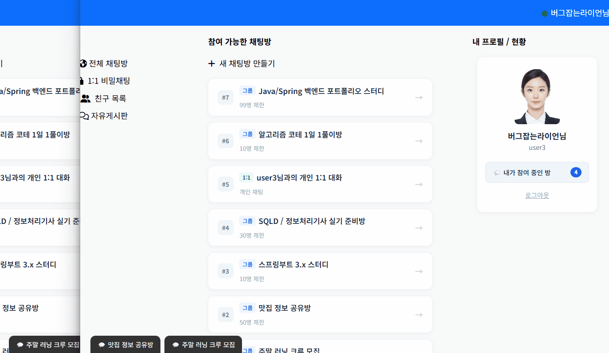
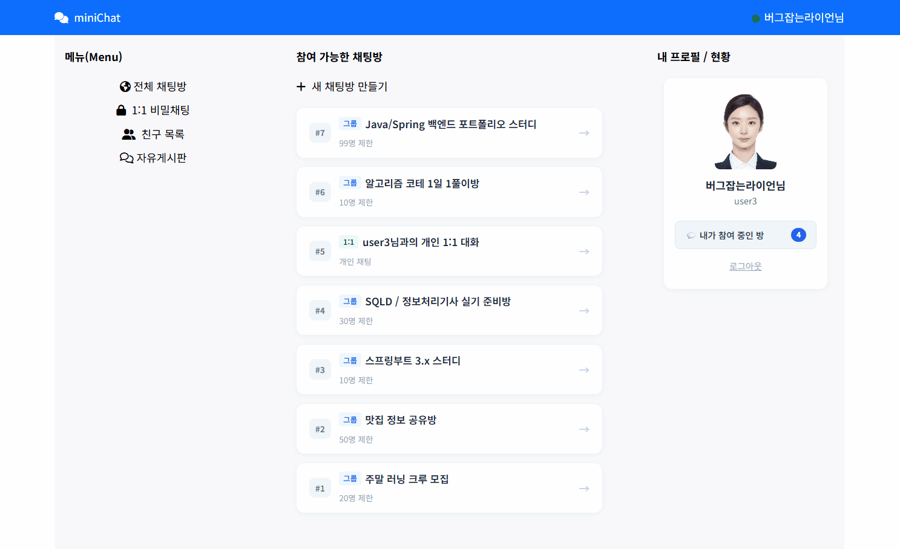
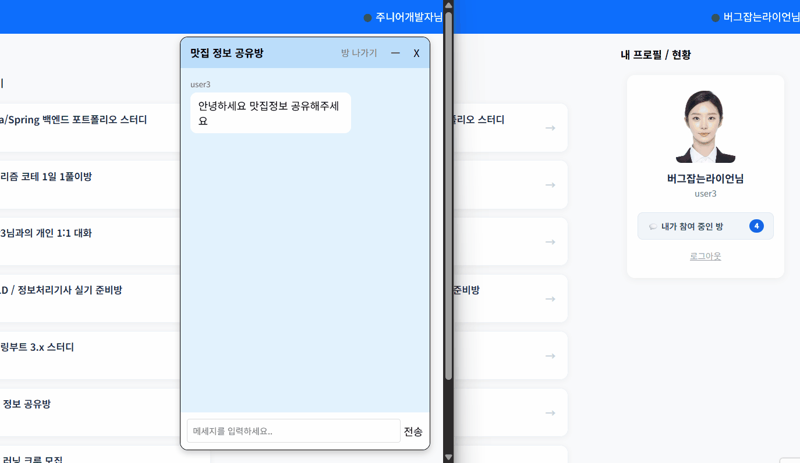
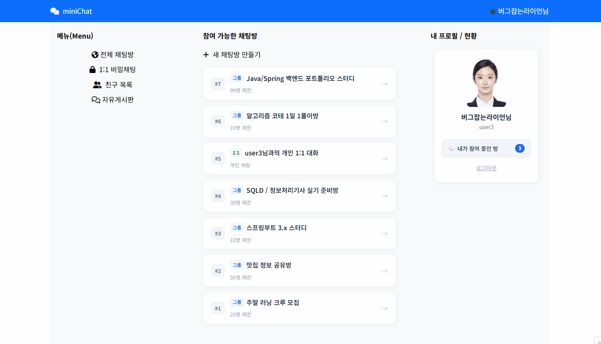
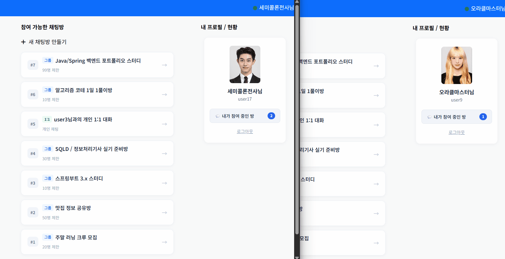

# miniChat

**여러 채팅방을 동시에 열고 대화할 수 있는 실시간 웹 채팅 프로그램입니다.**

메시지를 주고받는 기능에서 시작해, 채팅창을 내리거나 다시 열었을 때 **메시지 옆의 ‘안 읽은 사람 수’가 어떻게 달라져야 하는지**를 고민하며 만들었습니다.

| 개발 기간 | 개발 형태 | 주요 기술 |
| --- | --- | --- |
| 2026.07 ~ 2026.09 | 개인 프로젝트 | Java · Spring Framework · MyBatis · Oracle · WebSocket/STOMP |



> 메시지 옆 숫자는 **그 메시지를 아직 읽지 않은 참여자 수**입니다. 예를 들어 숫자가 2라면, 해당 메시지를 아직 읽지 않은 사람이 두 명이라는 뜻입니다.

## 어떤 기능을 만들었나요?

| 기능 | 사용자가 할 수 있는 일 |
| --- | --- |
| 실시간 대화 | 같은 채팅방의 사람들과 새로고침 없이 메시지를 주고받습니다. |
| 여러 채팅방 이용 | 한 화면에 여러 채팅창을 열고 대화할 수 있습니다. |
| 채팅창 최소화·복원 | 창을 아래로 내려두었다가 하단의 방 이름을 눌러 다시 엽니다. |
| 채팅창 닫기 | 창만 닫고 방 참여는 유지합니다. 목록에서 다시 열 수 있습니다. |
| 참여 중인 방 조회 | 전체 채팅방과 내가 참여한 채팅방을 나누어 확인합니다. |
| 대화 내역 조회 | 내가 해당 방에 참여한 시점 이후의 대화를 불러옵니다. |
| 읽음 상태 반영 | 채팅창을 다시 열면 새로 확인한 메시지의 ‘안 읽은 사람 수’가 줄어듭니다. |

<details>
<summary><strong>다른 기능의 시연 화면 보기</strong></summary>

### 여러 채팅창 열기와 최소화·복원

여러 방을 동시에 열고, 잠시 내려둔 창은 하단에서 다시 불러옵니다.



### 실시간 메시지 전송

메시지를 보내면 같은 방에 있는 상대방의 화면에도 표시됩니다.



### 참여 중인 채팅방 조회

내가 참여한 방만 모아 확인할 수 있습니다.



### 참여 이후의 대화 불러오기

방에 처음 참여한 시점을 기준으로, 그 이후에 오간 메시지를 조회합니다.



</details>

## 가장 많이 고민한 기능: 메시지 옆의 숫자

개발 기록에는 “채팅 보내기까지 완료~” 다음으로 “안 읽은 메시지 수, 생각보다 복잡…”이라는 메모가 남아 있습니다.

메시지를 보내는 기능을 만든 뒤에는, 사용자가 창을 내리거나 다시 여는 행동도 읽음 상태에 반영해야 했습니다. 이 과정에서 **무엇을 읽었다고 볼 것인지, 어디까지 처리할 것인지, 다른 사람의 화면에는 어떻게 알릴 것인지**를 하나씩 정했습니다.

### 1. 서버에 연결되어 있으면, 메시지를 읽은 걸까요?

처음에는 서버와 연결되어 있는지를 기준으로 읽음 상태를 판단하려 했습니다. 하지만 채팅창을 내려놓아도 연결은 유지되고, 새 메시지도 계속 받을 수 있었습니다. 메시지를 받을 수 있다는 사실만으로 읽었다고 처리하기에는 부족했습니다.

그래서 **채팅창을 열어 둔 상태인지**를 별도로 기록했습니다.

| 채팅창 상태 | 이 프로젝트에서 정한 읽음 처리 기준 |
| --- | --- |
| 열려 있음 | 새로 도착한 메시지를 읽은 것으로 처리합니다. |
| 최소화하거나 닫아 둠 | 새 메시지를 읽지 않은 것으로 남겨 둡니다. |
| 다시 열기 | 이전에 읽은 위치 이후에 쌓인 메시지를 읽음 처리합니다. |

이 기준에 따라 메시지를 보낼 때는 창을 내려놓거나 닫아 둔 참여자 수를 함께 저장하고, 창을 열어 둔 참여자는 마지막으로 읽은 위치를 갱신했습니다.

여기서 ‘읽음’은 **프로그램 안의 채팅창 열림 상태를 기준으로 한 처리**입니다. 브라우저 탭의 활성 여부나 사용자의 실제 시선까지 확인하는 방식은 아닙니다.

### 2. 오류는 없는데, 왜 숫자가 줄지 않았을까요?

채팅창을 다시 열어도 안 읽은 사람 수가 줄지 않는 문제가 있었습니다. SQL 오류는 발생하지 않았지만, 데이터를 바꾸는 순서에 문제가 있었습니다.

예를 들어 사용자가 10번 메시지까지 읽은 뒤 창을 내려놓았고, 그사이 11~13번 메시지가 도착했다고 가정해 보겠습니다. 창을 다시 열면 **11~13번 메시지만 새로 읽은 것으로 처리**해야 합니다.

그런데 이 처리를 하기 전에 ‘13번까지 읽었다’고 기록부터 바꾸고 있었습니다. 그 기록으로 아직 읽지 않은 메시지를 찾으니, 처리할 대상이 없어졌습니다.

수정한 흐름은 다음과 같습니다.

1. 사용자가 이전에 어디까지 읽었는지 확인합니다.
2. 그 이후에 새로 확인한 메시지들의 ‘안 읽은 사람 수’를 1씩 줄입니다.
3. 처리가 끝나면 마지막으로 읽은 위치를 갱신합니다.

현재 코드에서는 새로 읽은 범위를 먼저 구해 전달하고, 서버에서 해당 범위의 읽음 처리 후 마지막 읽은 위치를 갱신합니다. 이 경험을 통해 **각 코드가 맞는지와 함께, 실행되는 시점의 데이터가 어떤 상태인지도 살펴야 한다는 점**을 배웠습니다.

### 3. 바뀐 숫자를 메시지마다 다시 조회해야 할까요?

DB에 읽음 상태를 저장한 뒤에도, 이미 열려 있는 다른 참여자의 화면에 그 변화를 알려주는 과정이 필요했습니다.

처음에는 메시지마다 바뀐 숫자를 DB에서 조회해 하나씩 전달하는 방법을 생각했습니다. 하지만 이 방식이라면 새로 읽은 메시지가 80개일 때 조회와 전송도 메시지마다 반복하게 됩니다.

이미 사용자가 새로 읽은 범위를 알 수 있으므로, **‘어디부터 어디까지 한 사람이 읽었다’는 정보를 전달하는 방식**으로 구현했습니다.

| 처음 고려한 방식 | 구현한 방식 |
| --- | --- |
| 메시지별 최신 숫자를 각각 조회하고 전달 | 새로 읽은 메시지의 범위를 구해 읽음 알림 한 번으로 전달 |
| 받은 숫자로 각 메시지의 표시를 갱신 | 전달받은 범위에 속한 메시지의 숫자를 화면에서 1씩 차감 |

서버는 같은 범위의 읽음 상태를 DB에 반영하고, 해당 방을 구독 중인 화면들은 읽음 알림을 받아 표시를 바꿉니다. 채팅방을 다시 열어 대화 내역을 불러올 때는 DB에 저장된 값을 사용합니다.

이 선택은 메시지마다 반복할 조회·전송을 줄이기 위한 설계 판단입니다. 범위를 구하는 조회와 DB 갱신은 별도로 수행하며, **‘한 번’은 읽음 변경을 알리는 전송을 의미합니다.**

<details>
<summary><strong>구현 중 함께 해결한 문제들</strong></summary>

### 같은 방을 다시 열 때 구독이 쌓이지 않도록 하기

채팅방에 들어갈 때마다 메시지 수신을 새로 등록하면, 같은 메시지를 여러 번 화면에 추가할 수 있습니다. 방별 구독을 따로 보관하고 이미 구독한 방은 다시 등록하지 않도록 처리했습니다.

### 방 번호가 같아 보여도, 자료형이 다르면 달랐던 문제

이미 열려 있는 방을 관리하는 과정에서 문자열 `"8"`로 저장한 방을 숫자 `8`로 제거하려 해 정상적으로 정리되지 않는 문제가 있었습니다. 방 번호를 문자열로 맞추고, HTML에서 함수로 값을 전달하는 부분도 일관되게 수정했습니다.

### 같은 방의 참여 기록이 중복으로 저장되지 않도록 하기

채팅창을 닫았다 다시 열 때마다 참여 정보를 새로 넣으면 같은 사용자의 기록이 중복될 수 있습니다. Oracle의 `MERGE`를 사용해 해당 방에 참여한 기록이 있을 때는 유지하고, 없을 때만 생성하도록 처리했습니다.

</details>

## 사용 기술과 구성

| 구분 | 기술 | 사용한 부분 |
| --- | --- | --- |
| 서버 | Java 11, Spring Framework 5.3.30 | 채팅방·메시지 요청 처리, 읽음 상태 갱신 |
| 데이터 저장 | Oracle, MyBatis | 대화 내역과 방 참여 정보 조회·저장 |
| 실시간 통신 | WebSocket, STOMP, SockJS | 방별 메시지 전송과 읽음 변경 알림 |
| 화면 | JSP, HTML/CSS, JavaScript, Ajax | 여러 채팅창 구성, 목록 조회, 수신 내용 표시 |
| 개발 도구 | STS, Maven, Git | 개발 환경, 의존성·빌드 및 변경 이력 관리 |

화면에서는 채팅방 목록과 대화 내역 등을 HTTP 요청으로 불러오고, 실시간 메시지와 읽음 변경은 WebSocket/STOMP로 주고받습니다.

```text
채팅 화면
   ├─ 목록·대화 내역 요청 → 서버 → DB 조회 → 화면에 표시
   └─ 메시지·읽음 정보 전송 → 서버에서 DB 반영 → 같은 방의 구독 화면에 전달
```

<details>
<summary><strong>주요 데이터가 맡은 역할 보기</strong></summary>

| 데이터 | 기록하는 내용 |
| --- | --- |
| 채팅방 (`ChatRoom`) | 방 제목, 유형 등 채팅방의 기본 정보 |
| 방 참여 정보 (`ChatRoomJoin`) | 누가 어떤 방에 언제 참여했는지, 창을 열어 두었는지, 어디까지 읽었는지 |
| 메시지 (`ChatMessage`) | 누가 어떤 내용을 언제 보냈는지, 그 메시지를 아직 읽지 않은 사람이 몇 명인지 |

방 참여 정보에 **사람별 마지막 읽은 위치**를, 메시지에는 **아직 읽지 않은 사람 수**를 저장해 읽음 처리를 연결했습니다.

</details>

### 코드는 여기서부터 볼 수 있습니다

채팅 기능의 주요 흐름을 따라갈 수 있도록 관련 파일만 정리했습니다.

| 살펴볼 내용 | 파일 |
| --- | --- |
| 채팅창 열기·닫기, 방별 구독, 수신한 메시지와 읽음 알림 표시 | [home.jsp](https://github.com/javagangyong/miniChatProject/blob/master/src/main/webapp/WEB-INF/views/home.jsp) |
| 채팅 메시지와 읽음 알림을 받아 같은 방에 전달하는 진입점 | [StompController.java](https://github.com/javagangyong/miniChatProject/blob/master/src/main/java/com/itbank/controller/StompController.java) |
| 메시지 저장과 읽음 처리의 실행 순서 | [ChatService.java](https://github.com/javagangyong/miniChatProject/blob/master/src/main/java/com/itbank/service/ChatService.java) |
| 대화 조회, 참여 정보 중복 방지, 범위별 읽음 처리 SQL | [chat-mapper.xml](https://github.com/javagangyong/miniChatProject/blob/master/src/main/resources/mybatis/chat-mapper.xml) |
| 채팅방 목록·대화 내역·읽은 위치 조회 요청 처리 | [HomeAjaxController.java](https://github.com/javagangyong/miniChatProject/blob/master/src/main/java/com/itbank/controller/HomeAjaxController.java) |

## 만들면서 배운 점

처음에는 메시지를 주고받을 수 있으면 채팅 기능의 큰 부분을 만든 것이라고 생각했습니다. 이후 창을 내리고, 다시 열고, 여러 방을 오가는 상황을 다루면서 사용자에게 익숙한 기능도 만드는 입장에서는 여러 조건을 정해야 한다는 것을 알게 되었습니다.

특히 읽음 처리 문제를 해결하면서 개별 SQL뿐 아니라 실행 순서와 데이터의 변화를 함께 보는 습관을 배웠습니다. DB에 저장한 값이 열린 화면에도 반영되도록 만드는 과정에서는, 데이터를 저장하는 일과 그 변화를 사용자에게 보여주는 일을 함께 설계해야 한다는 점을 경험했습니다.

프로젝트 전반에서 AI에 구현 방향, 전체 흐름, 코드 작성 방법을 질문하며 도움을 받았습니다. 이해되지 않는 설명이나 코드는 다시 확인한 뒤 한 줄씩 직접 작성했고, 각 코드가 필요한 이유와 앞뒤 처리의 연결을 이해하며 진행했습니다.

## 현재 구현 범위와 보완할 부분

현재는 프로그램 안에서 채팅창을 열고, 최소화하고, 다시 여는 동작을 중심으로 읽음 상태를 처리합니다. 다음 상황은 추가 보완이 필요합니다.

- **연결이 끊기거나 여러 화면에서 접속하는 상황:** 브라우저 종료·연결 끊김에 따른 상태 정리와, 같은 계정으로 여러 탭에 접속했을 때의 읽음 기준을 보완해야 합니다.
- **읽음 요청이 겹치는 상황:** 같은 읽음 알림이 반복되거나 새 메시지 수신과 읽음 처리가 겹칠 때, 이미 처리한 범위를 다시 차감하지 않도록 서버 검증을 보완해야 합니다.

<details>
<summary><strong>로컬 실행을 준비한다면</strong></summary>

- Java 11과 Maven을 사용하는 Spring Framework 프로젝트이며, WAR 형태로 구성되어 있습니다.
- Oracle DB와 프로젝트의 테이블·시퀀스가 필요합니다. 현재 저장소에는 DB를 처음부터 생성하는 SQL 스크립트가 포함되어 있지 않아, 실행 환경을 재현하려면 해당 자료를 별도로 준비해야 합니다.
- DB 연결 설정은 [root-context.xml](https://github.com/javagangyong/miniChatProject/blob/master/src/main/webapp/WEB-INF/spring/root-context.xml), 웹 애플리케이션과 실시간 통신 설정은 [servlet-context.xml](https://github.com/javagangyong/miniChatProject/blob/master/src/main/webapp/WEB-INF/spring/appServlet/servlet-context.xml)에서 확인할 수 있습니다.

</details>
